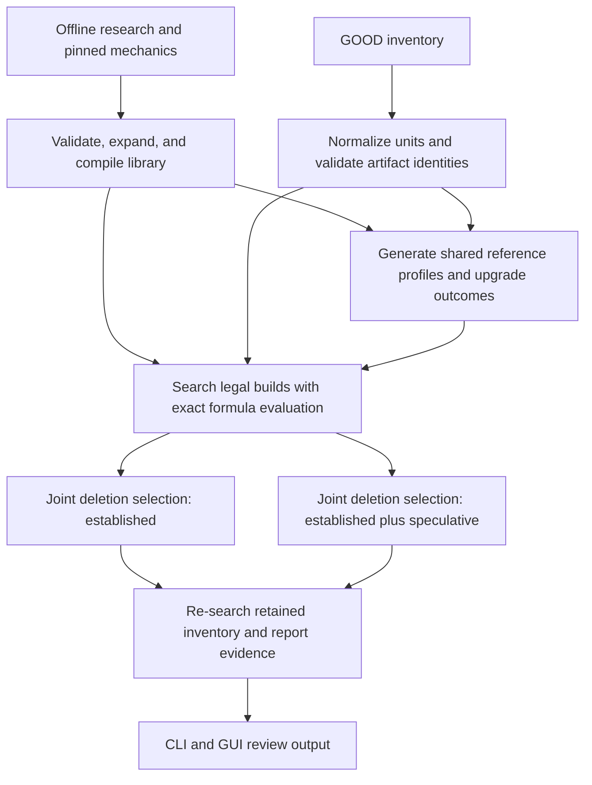

# Deletion analysis: architecture and decision record

Updated: 2026-10-05. Prepared with Codex assistance from repository inspection
and the design conversation.

This records the intended architecture, confirmed policy decisions, consequences,
and remaining choices. It is not a claim that the new deletion pipeline exists,
or a decision-complete implementation specification. Confirmed decisions take
precedence over unresolved proposals in the older `plan.txt` handoff.

## Purpose and current implementation

Preserve useful artifacts across established released-character roles and
plausible speculative uses, including unfinished artifacts and incomplete sets.
A sparse Genshin Optimizer (GO) database must not define deletion coverage.
Analysis uses an offline numerical library; no LLM interprets formulas at runtime.

The v4 loader, variant expansion, arithmetic compiler, dependency tracking,
scalar aggregate-stat evaluator, collection selection, and compiled-content
fingerprints exist. The evaluator handles actual set counts, staged effects,
conversions, and scenario constraint violations. It does not assemble or certify
five distinct legal artifacts.

The previous CLI deletion command remains available. The new path has lossless
inventory import, legal-build search, automatic weights, quantile profiles,
coupled futures, exhaustive deletion selection, and a build-pool MILP with
retained-inventory re-search. `library-delete` and the GUI's authored-library
cleanup mode expose both independent lists as diagnostics. Legacy calculations
use percentage points; the new evaluator uses decimal ratios. Draft game
coverage prevents a production-preservation claim. Proven nonpositive baselines
are excluded and reported rather than blocking measurable targets.
See [implementation notes](deletion-analysis-implementation.md).
The pilot remains draft game coverage despite engine-contract tests.

## End-to-end architecture

### Library and mechanics

- Retain established, parameter-variation, and structural-variation collections.
  Documented alternatives remain established; collection membership is not a
  probability or account-priority weight.
- Research records contain sources, derivations, assumptions, validation cases,
  and coverage gaps. Numerical components and activation encode runtime behavior.
- Require pinned numerical mechanics. A publisher's `validated` assertion is
  not independent game verification. Unknown mechanics are visible gaps.
- Coverage defaults to all supported released roles, including unowned
  characters, with explicit exclusions. Archetypes supply additional coverage.

### Inventory boundary and legal builds

- Normalize source percentages exactly once. Ratios, main-stat tables, roll
  increments, buffs, thresholds, calculations, caches, and display conversion
  must agree. Never infer units from numerical magnitude.
- Enforce stable unique identities, one artifact per slot, slot/main legality,
  and actual candidate set counts. Keep provenance and unfinished-state data.
- Distinguish actual current stats from modeled completed stats. In particular,
  do not use the legacy level-20 main-stat approximation as evidence of current
  feasibility for an unfinished artifact.
- Preserve applicable equipped, starred, and explicitly pinned protections;
  expose their reasons. Ordinary locks alone do not protect artifacts. GO
  coverage and legacy GO-winner protection are not automatically requirements
  of the new design.

### Search and exact evaluation

- Use the compiled evaluator for build scores, effects, and constraints.
  Track indirect stat dependencies; relevance does not prove monotonicity.
- Provide exhaustive enumeration for small legal inventories as a correctness
  reference. Search larger inventories with bounded candidate and build pools.
- Gradients may order swaps and candidates. Exact-evaluate retained candidates;
  refresh local weights as contexts change. Explore multiple starting builds,
  set strategies, threshold regimes, and coordinated swaps.
- Do not reuse positive-weight dominance pruning without proving it valid for
  the particular formulas, constraints, and identity needs.
- Provide a bounded mode taking at most several minutes and an optional longer
  mode. A deadline returns a qualified feasible incumbent or an unresolved
  result. Failure to find a solution is not proof of infeasibility.

### Percentile reference complements

Reference artifacts model possible surroundings for real inventory pieces.
They do not predict future farming or become freely available substitutes for
the real pieces under evaluation.

- Use legal artifact stat vectors and roll histories, not invented aggregate
  totals or one averaged vector. Generate reproducible samples and cache them.
- Percentiles cover the entire slot, including all legal main stats and their
  occurrence probabilities. Main-stat rarity contributes to the quality
  definition; do not condition reported percentiles on the desired main stat.
  Stratified sampling by main stat is allowed, but combine conditional score
  distributions using their actual main-stat probabilities. Scores must be
  comparable across main stats, not independently normalized ranks.
- Derive local stat weights automatically through the complete compiled
  evaluator: `w = gradient(score, aggregate artifact additions)` in a fixed
  surrounding build. Include conversions and indirect effects. Do not author
  subjective stat weights or silently discard negative derivatives.
- Within a fixed context, rank sampled artifacts by `w dot artifact_stats`.
  These are percentiles of a defined local surrogate, not exact percentiles of
  the nonlinear game formula. Integer-weight percentile dynamic programming
  is optional future optimization, not a prerequisite.
- Separate discrete set activations and main-stat alternatives. Handle hard
  constraints separately; zero damage derivative does not make ER irrelevant.
- Use shared context portfolios for competing artifacts. Preserve diverse stat
  allocations, including different ways to supply required stats. Verify
  assembled builds with the exact formula; a finite sample with one quantile
  representative does not establish sufficient allocation diversity.
- Ordinary and strong profiles drive primary future losses at the 80th and
  95th whole-slot percentiles. Define a quantile as the smallest score whose
  cumulative probability reaches the target. Keep the entire tied score group
  and report its percentile interval. The initial production profile design
  has no arbitrary quality-band width or automatic sampling controller.
- Sample count is a computational setting, not the definition of quality.
  Report finite-sample quantile uncertainty separately, using order-statistic/
  binomial bounds for independent unconditional samples. Do not silently turn
  uncertainty into a wider complement profile. Check sensitivity across seeds
  and sample counts; this measures sampling stability, not game accuracy.
- Exceptional complements use the 99th whole-slot percentile with the same
  quantile definition and complete tie groups. They supply explanations and a
  secondary tie-breaker; they cannot worsen either primary objective.
- Freeze profiles, weights, samples, and context portfolios before joint
  selection. Original and retained inventories use identical assumptions.
- Initialize shared contexts from both independently sampled hypothetical legal
  builds and good current-inventory builds. Hypothetical contexts cover missing
  owned sets/roles; inventory contexts capture actual stat balance. Include both
  sources in the frozen portfolio, with separate search-status evidence.

Context selection remains a modeling assumption even with automatic weights.
Exact final evaluation cannot recover opportunities omitted during profile
generation. Report sensitivity and nonlinear ranking disagreement rather than
claiming an unspecified accuracy guarantee.

### Joint future opportunities

Measure the value lost by a deletion set, not the sum of isolated artifact
potential scores. Interchangeable pieces provide overlapping opportunities;
pieces in different slots may be useful only together.

- Future builds combine retained real pieces with reference complements and
  modeled completed outcomes. Hypothetical pieces occupy only their designated
  complement slots, never the real slots being tested.
- Test all 31 nonempty subsets of the five slots. Each subset designates real
  slots; the search chooses retained inventory pieces for those slots, with
  hypothetical complements only in the remaining slots. The all-real subset
  tests completed upgrade outcomes without hypothetical complements.
- Compare original and retained inventory under the same sampled outcomes,
  coupled by stable artifact identity. Removing an artifact must not resample
  the surviving artifacts' futures.
- Within a quality profile, alternative complement allocations are build
  choices: take the best achievable qualifying result. Ordinary and strong
  profiles are separate preservation targets, with worst loss across them.
- Average genuinely random upgrade outcomes using the roll model's
  probabilities. Quality profiles do not have invented acquisition probabilities.
- Do not silently skip unknown substats or incomplete sets. Missing outcomes
  require explicit modeling or coverage protections.
- No qualifying baseline is a visible opportunity gap, not numerical evidence
  of redundancy. When a positive qualifying baseline exists and deletion
  removes qualification, report the lost opportunity explicitly.

The confirmed model is expected best achievable performance after finishing
retained candidates and observing their upgrades, without a shared upgrade
budget. The user prefers redundancy and conservative deletion. This preserves
the option to choose winners afterward; it is not a forecast of upgrades the
user will actually perform. Additional interchangeable candidates provide
diminishing opportunity value rather than independent protection scores.

**Performance note:** all 31 slot patterns can be a computational pain point,
especially when multiplied by scenarios, quality profiles, complement portfolios,
and sampled upgrade outcomes. Record costs by pattern during implementation.
Reuse evaluations and search work where possible. If profiling identifies this
as a bottleneck, using fewer patterns is a potential substantial speedup, but
also omits modeled opportunities and can miss multi-piece interactions. The
size of the speedup is not guaranteed: patterns have different costs and may
share work. Do not implement a reduced-pattern mode merely in anticipation of
this issue; retain the full model unless measurements justify another option.
More patterns broaden modeled opportunity coverage, not proof of better
predictions about actual future inventory.

## Confirmed selection policy and consequences

| Decision | Reason and consequence |
| --- | --- |
| Two independently selected lists | Established-only and combined runs start from the same inventory with comparable settings. Neither list is a filter of the other. |
| Equal established/speculative priority in combined run | Speculation may justify a different allocation of current losses; there is no established-first objective. |
| Preserve independent builds | Artifacts may serve different scenarios; simultaneous team assignments and mandatory reserve builds are outside the initial scope. |
| Exact deletion count | Return the requested count when feasible under protections. Otherwise explain infeasibility or unresolved search. |
| Locks alone do not protect | The user locks all artifacts and uses stars for explicit protection. Retain lock metadata, but do not invent a weaker lock preference. |
| Preserve current feasibility | Every currently feasible covered scenario must retain a qualifying real build. Hypothetical artifacts cannot satisfy this protection. |
| Worst relative loss, then family-balanced average | Protect the most affected use first. Average contexts within current/ordinary/strong categories, give those three categories equal shares within a family, then average families equally. The 31 future patterns do not multiply their category's influence. |
| Current and future losses are primary targets | Future opportunity can justify some current score loss, subject to current-feasibility protection. |
| Worst ordinary/strong profile loss | Preserve usefulness across reasonable surrounding-build qualities without inventing probabilities for those qualities. |
| Exceptional value is secondary, at the 99th percentile | Preserve specialized potential when primary outcomes are equivalent, without assuming heavy investment in every set. Use the same whole-slot quantile and tie rules. |
| Whole-slot percentiles | Include main-stat occurrence probability; a rare useful main stat must not be judged only against artifacts already possessing it. |
| Finish candidates, then choose | Preserve upgrade options without a shared resource budget; this favors redundancy and conservative retention. |
| Failed future outcomes contribute zero | Average qualifying performance over all modeled upgrade trials and also report qualification probability. Unresolved searches and absent baselines remain gaps. |
| All 31 nonempty real-slot subsets | Include multi-piece opportunities. This may be expensive; reducing patterns is a documented optimization point if needed, with a coverage tradeoff. |
| No automatic simple-target downweighting | A supported pure-HP role remains a target. Improve inaccurate proxies; handle redundant pieces jointly rather than manufacturing distinctions. |
| Protect or block unsupported coverage | Protect affected inventory when it can be bounded; otherwise withhold recommendations claiming intended coverage was preserved. Diagnostic results remain available. |
| Release a validated subset first | The software can become useful before full coverage, but early coverage protections may prevent an exact-count recommendation. |

For a positive baseline `B` and retained performance `R`, relative loss is
`1 - R / B`. Scores with zero, negative, undefined, or absent baselines need
explicit reporting; do not apply a meaningless ratio or silently count them as
zero loss. The evaluator may compute an infeasible score, but that does not make
it a usable build score.

Family grouping is settled: one family per character and role. Weapon, set,
and parameter variants share their role's family; genuinely different roles
have separate families. Generic archetypes have their own families. A speculative
structural variant shares a family when it preserves the same character and
role, otherwise it declares a separate family. Parameter variants inherit the
parent family and cannot override it. Authors declare explicit `family` IDs;
the runtime does not infer grouping from scenario names or character lists.
Missing metadata is permitted for existing build diagnostics, but needs explicit
completion before a family-balanced deletion release. Normalization is settled:
current, ordinary-future, and
strong-future categories have equal shares within each family. Average contexts
inside each measurable category, then average measurable categories and families
equally. Proven nonpositive baselines are excluded and explicitly reported by
scenario; unknown evidence still blocks selection. If no primary target remains,
produce no deletion list. Exceptional losses
remain separate from both primary objectives.

## Selection, verification, persistence, and output

Build pools provide candidate alternatives for joint selection. The legacy MILP
is a possible reusable component. The selected implementation approach is a
build-pool MILP with retained-inventory re-search/refinement, checked against
exhaustive deletion selection on small cases. Future outcome
targets may need outcome-specific build alternatives. Re-search after selection
should discover omitted retained alternatives and feed useful alternatives back
into the pool within the runtime budget.

A joint solver optimum over a pool is not an optimum over all legal builds.
Verification should distinguish exact small-case results, pool-relative solver
results, and heuristic search results. Never let a legacy `verified` boolean
imply formula accuracy, complete coverage, or global deletion optimality.

Persist reusable numerical work at appropriate layers: expanded definitions,
compiled-program metadata, artifact samples and outcomes, reference portfolios,
build evaluations/search results, and deletion results. Keys include numerical
content and validation provenance, mechanics/evaluator versions, inventory
identities and states, exclusions/protections, profile and sampling definitions,
selected collections, objective settings, and search budgets. Validate draft
eligibility independently of any numerical cache hit.

CLI and GUI should expose the library/mechanics selection, exact deletion count,
coverage exclusions, protections, runtime modes, and diagnostic status. Review
output contains artifact identities, baseline/retained builds, scenario losses,
binding protections, future contexts, coverage gaps, and reasons the two lists
differ. A displayed order does not certify independently optimal deletions or
safe prefixes of the joint list. Analysis does not modify inventory source files.

Do not use a single trust score or label. Report separately:

- Formula validation: independent reference evidence and known approximations.
- Coverage: included uses, explicit exclusions, unsupported uses, and protections.
- Search: exact, pool-relative, approximate, timed out, or proven infeasible.
- Future assumptions: reference percentiles, contexts, roll model, resource
  interpretation, and sensitivity.

These statuses do not change scenario weights or artifact scores.

## Validation and implementation sequence

1. Integrate normalized inventory and legal-build evaluation with the library.
   Migrate dependent legacy units coherently or isolate them behind explicit
   adapters. Test percentage conversion, identities, slots, mains, and set counts.
2. Establish independently validated formula/effect cases and a gap registry.
   Test caps, indirect conversions, activation changes, and scenario constraints.
3. Implement exhaustive small-case search and bounded search. Compare build
   results and record errors rather than asserting unspecified tolerances.
4. Generate percentile profiles with automatic weights and coupled future
   outcomes. Test reproducibility, legal rolls, point quantiles and ties, diversity,
   and sensitivity to context and quality assumptions.
5. Implement both joint deletion runs. Compare small deletion problems against
   exhaustive subset enumeration, including substitute unfinished pieces,
   complementary multi-slot pieces, sole set pieces, and feasibility loss.
6. Add persistent caching, CLI/GUI review, explanations, deadlines, and progress.
   Test invalidation, protected-count conflicts, timeout/infeasibility distinction,
   and incomplete-coverage behavior.
7. Evaluate regret against held-out scenarios and upgrade outcomes. Separate
   empirical generalization evidence from guarantees about modeled coverage.

Current verification results are recorded in the implementation notes. Passing
software tests does not certify independently validated game coverage.

## Remaining implementation specification

The three product choices previously pending are settled: whole-slot percentiles
with main-stat occurrence probabilities; finish candidates and choose afterward
without a shared upgrade budget; and all 31 nonempty real-slot subsets. A
reduced-pattern mode is not required now.

Family grouping and category averaging are settled. Remaining specification
work includes quantile estimation, context diversity, verified roll probabilities,
and installed mechanics/reference fixtures. These must be explicit and versioned,
but do not all require personal preference questions. Runtime measurements and
diagnostic experiments can inform numerical settings. Do not silently promote
provisional runtime defaults into confirmed modeling choices.

### Possible later percentile extensions

Quality bands and additional configuration may be useful later, but are not
part of the first production-profile design. A band deliberately models a range
of surrounding artifact quality; its width is a modeling preference, not a
statistically derived consequence of quantile uncertainty. If added, distinguish
it from confidence intervals, document its effect, and compare recommendations
against the point-quantile model. Adaptive sampling and source-specific quality
distributions are also potential later extensions. Avoid a generalized policy
framework before concrete cases justify one. The existing `ScorePopulation.band`
API remains a diagnostic primitive, not an approved production-band default.

### Audit of tuning and assumptions

- **Context portfolio:** selecting surrounding builds changes local gradients
  and which opportunities are visible. The prototype's top-eight contexts,
  32 candidates per set/slot, and equal source-time split are provisional
  engineering choices, not mathematical definitions of sufficient coverage.
  Diversity must have an explicit meaning; avoid inventing weighted stat-distance
  thresholds merely to obtain a convenient number of contexts.
- **Search and build pools:** evaluation limits, random starts, retained build
  counts, and MILP refinement limits affect approximation quality. Track exact
  or approximate status, compare small cases against exhaustive search, and report
  sensitivity. A budget alone does not certify a loss bound.
- **Sampling:** population size, upgrade-trial count, and random seed affect
  numerical uncertainty. Freeze common samples across baseline/removal runs;
  define reported confidence levels explicitly. A statistically justified
  interval is conditional on the probability model and sampling assumptions.
- **Game distributions:** main/substat weights, starting-line probabilities,
  and roll-tier probabilities need source evidence. The draft legacy assumptions
  are not parameters to tune until recommendations look plausible.
- **Scenario authoring:** roles, rotations, uptime, enemy assumptions, and ER
  requirements are substantive model inputs. Pin evidence and encode meaningful
  alternatives rather than burying adjustments in the deletion engine.
- **User policy:** 80th/95th primary quality and 99th exceptional quality, equal family/category influence,
  conservative finish-and-choose value, and protections are explicit preferences.
  Mathematical precision implements these preferences but cannot prove they are
  the uniquely correct preferences. Exceptional quality is secondary and cannot
  alter either primary objective.
- **Numerics:** solver tolerances, near-tie handling, and any score floors can
  affect selection. Use documented numerical error/solver bounds where available;
  do not introduce a heuristic loss floor or protection-probability cutoff.
- **Legacy UI:** existing probability-floor and candidate-limit settings belong
  to the previous analyzer. They are not inherited requirements of the new path.
